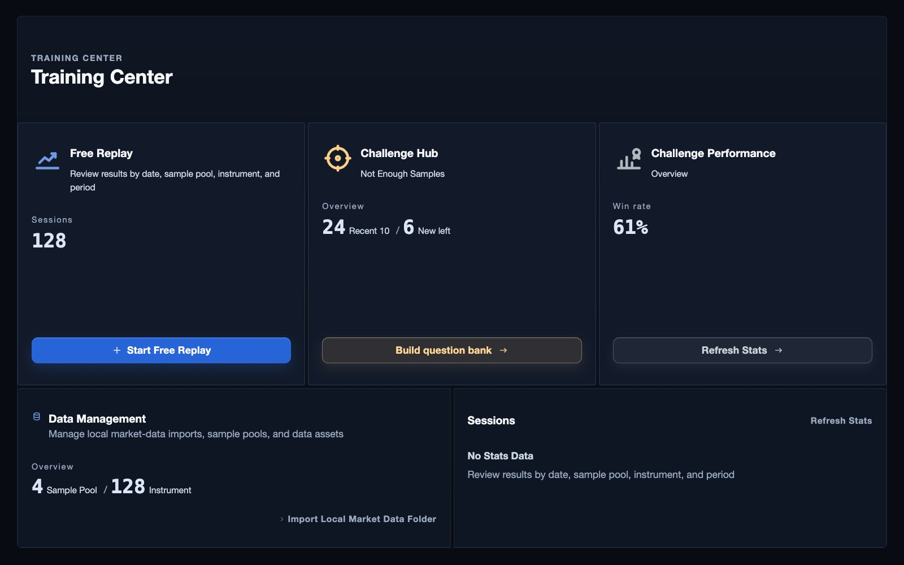
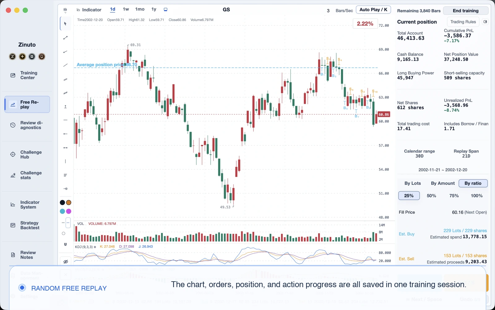
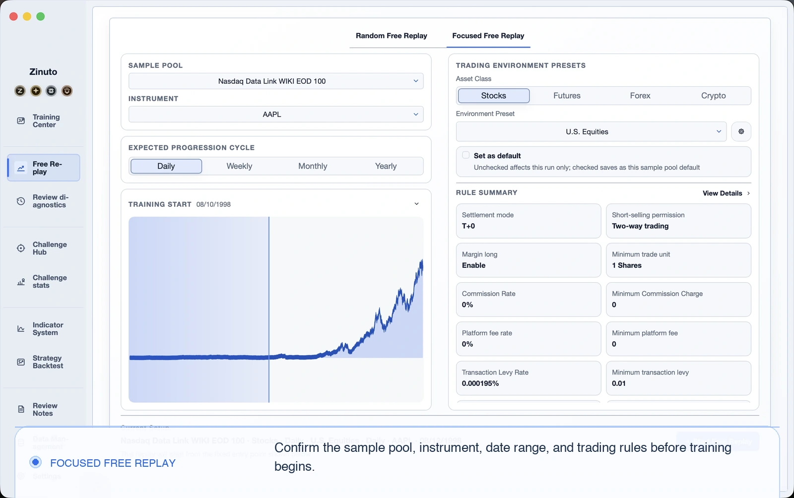
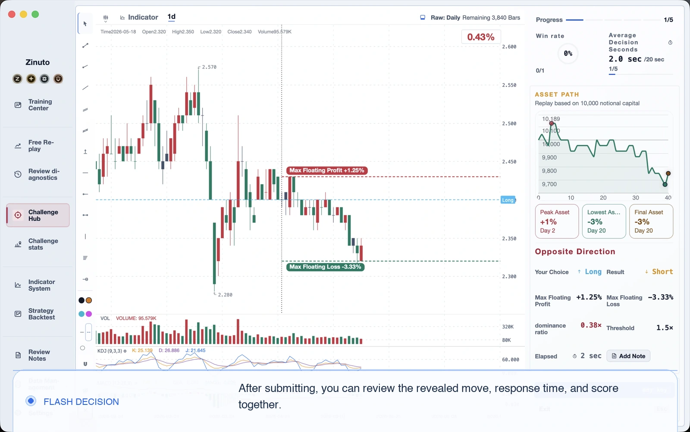
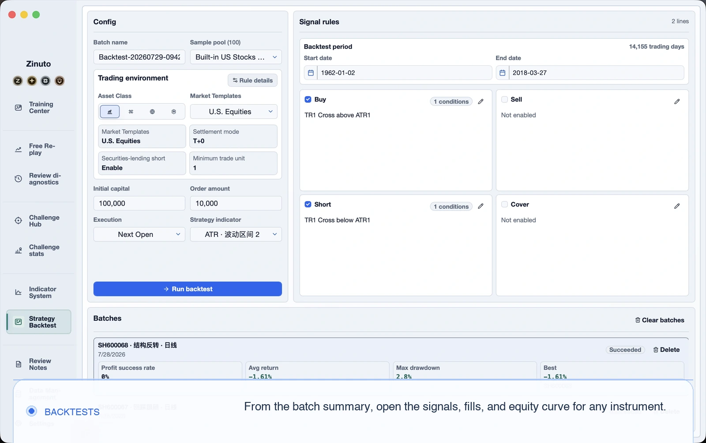
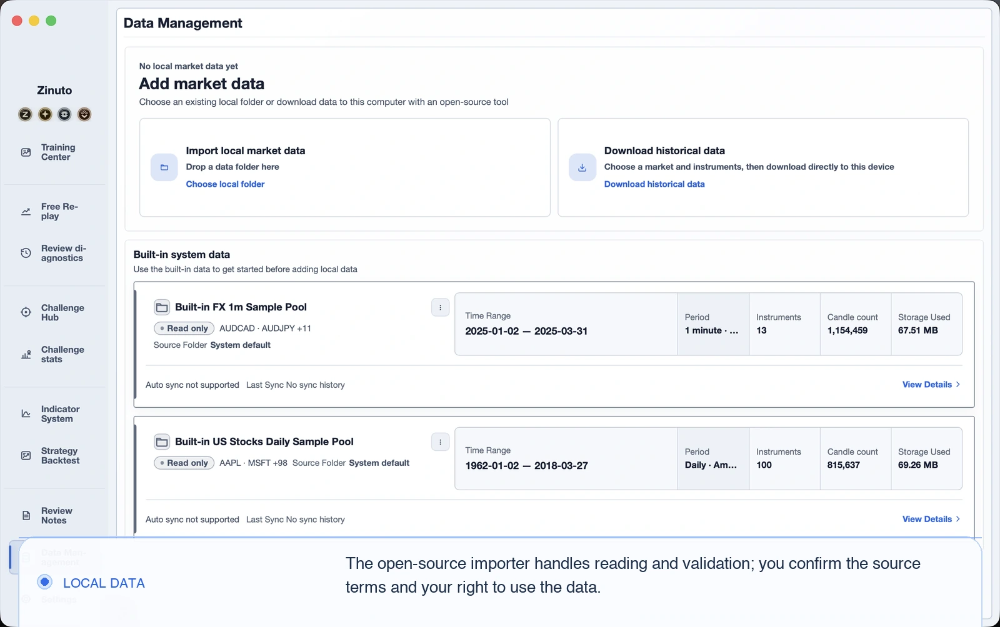

<a id="top"></a>

<table>
  <tr>
    <td width="34%" valign="middle" align="center">
      <p align="center"></p>
      <h1 align="center">Zinuto Core</h1>
      <p align="center">A desktop workspace for market replay, deliberate practice, and strategy backtesting on your own computer.</p>
    </td>
    <td width="66%" valign="middle">
      
    </td>
  </tr>
</table>

<p align="center">
  <a href="#build-and-run">Build Core</a> ·
  <a href="#contribute">Contribute</a>
</p>

<p align="center">
  <strong>English</strong> ·
  <a href="README.zh-CN.md">简体中文</a> ·
  <a href="README.ja.md">日本語</a> ·
  <a href="README.ko.md">한국어</a> ·
  <a href="README.es.md">Español</a>
</p>

> Zinuto has been discontinued. If you wish to continue using the local tools, you can build Core from the source in this repository by following the build instructions below. Core runs locally without an official account or hosted service. Official downloads, account services, and product updates are no longer available.

Core does not connect to a broker or place real orders. It is a research and practice tool, not investment advice. Once your data is available locally, the main workspace can be used without an account or a continuous network connection. Optional data connectors make outbound requests only when you start an acquisition. Those requests go directly from your computer to the selected provider, not through a Zinuto service. The provider sees your public IP or the egress IP of your proxy or VPN.

## What you can do

| Workspace | What it helps you do |
| --- | --- |
| Local data | Preview, map, validate, and import CSV, JSON, Parquet, and XLSX files |
| Market replay | Step through historical sessions, record decisions, and review them later |
| Practice | Use simulated trading, training banks, and focused challenges |
| Backtesting | Run the Rust strategy engine and inspect fills, metrics, and charts |
| Review | Keep notes, indicators, history, saved results, and portable data packages |
| Language | Use English, Simplified Chinese, Japanese, Korean, or Spanish |

<table>
  <tr>
    <td width="50%" valign="top">
      <a href="docs/assets/readme/free-replay.en.webp"></a>
    </td>
    <td width="50%" valign="top">
      <a href="docs/assets/readme/directed-replay.en.webp"></a>
    </td>
  </tr>
  <tr>
    <td width="50%" valign="top">
      <a href="docs/assets/readme/flash-decision.en.webp"></a>
    </td>
    <td width="50%" valign="top">
      <a href="docs/assets/readme/strategy-backtests.en.webp"></a>
    </td>
  </tr>
  <tr>
    <td colspan="2" valign="top">
      <a href="docs/assets/readme/local-data.en.webp"></a>
    </td>
  </tr>
</table>

_These screens show local simulated training and data workflows. They contain no official account or private service layer._

Your working data stays in local application storage unless you explicitly export a portable package. Portable packages are unencrypted by design, so treat exported files as sensitive and store them accordingly.

<a id="build-and-run"></a>

## Build and run

### Prerequisites

| Requirement | Notes |
| --- | --- |
| Git | Required to clone and contribute |
| Node.js | Use the exact version in [`.nvmrc`](.nvmrc) |
| Rust | Install the stable toolchain with [rustup](https://rustup.rs/) |
| uv | Use version `0.11.8`; it provisions the pinned Python runtime |
| System tools | Follow the [Tauri 2 prerequisites](https://v2.tauri.app/start/prerequisites/) for macOS or Windows |

On macOS, install Xcode Command Line Tools. On Windows, install the Microsoft C++ Build Tools and WebView2 listed by Tauri.

### Start the desktop app

```sh
git clone https://github.com/Zinuto-Official/zinuto-core.git
cd zinuto-core
npm ci
npm start
```

The first run builds the local Node.js runtime, Rust backtest engine, and pinned Python data sidecar. It can take several minutes and needs network access to fetch development dependencies. Later runs reuse the local build cache.

### Build an installer

```sh
npm run package -- --output-dir /absolute/path/to/output
```

This creates a self-built `Zinuto-Core-<version>.dmg` or `.exe` with checksums and build evidence. It is not signed or notarized by Zinuto, is not an official release, and is never uploaded by this repository's workflows. Cross-platform packaging is not supported, so build the installer on its target operating system.

### Run the checks

```sh
npm run check:fast -- --working-tree
npm run check:affected -- --base origin/main --head HEAD
npm run check:public-repo
```

`npm run check:full` is the complete release-candidate gate and takes longer. See [CONTRIBUTING.md](CONTRIBUTING.md) for the checks required by each part of the codebase.

### Repository map

| Path | Responsibility |
| --- | --- |
| `apps/desktop/web` | React interface embedded in the desktop app |
| `apps/desktop/local-api` | Local application services and SQLite/DuckDB storage |
| `apps/desktop/shell` | Tauri lifecycle, filesystem staging, and native bridge |
| `apps/desktop/backtest-engine` | Rust backtest sidecar |
| `packages/shared` | Contracts, validation, domain logic, and five-language copy |
| `contracts` | Versioned local HTTP and native bridge contracts |
| `tools` | Build, packaging, generation, and repository checks |

For design boundaries, start with [Architecture](docs/ARCHITECTURE.md). For sample-data sources and licenses, see [THIRD_PARTY_DATA.md](THIRD_PARTY_DATA.md).

<a id="contribute"></a>

## Contribute

You do not need to understand the whole project before helping. A reproducible bug report, a clearer translation, a focused test, or a small patch can be valuable.

1. Search existing issues. Open a bug or feature request if the work has not been discussed.
2. Fork the repository and create a focused branch in your fork.
3. Read [CONTRIBUTING.md](CONTRIBUTING.md), [GOVERNANCE.md](GOVERNANCE.md), and the applicable license agreement in [CLA.md](CLA.md).
4. Make one coherent change. Update all five locales when user-visible copy changes.
5. Run the affected checks and add screenshots for visible interface changes.
6. Open a pull request to this repository's default branch and explain the user impact.

Maintainers develop on `main`. External contributors use branches in their own forks. Please report security issues privately through [SECURITY.md](SECURITY.md), not through a public issue.

## License, safety, and brand

- Code: [`GPL-3.0-only`](LICENSE). Contributors retain copyright; see [CLA.md](CLA.md).
- Security: report vulnerabilities privately as described in [SECURITY.md](SECURITY.md).
- Redistribution: follow [BRANDING.md](BRANDING.md) and [TRADEMARKS.md](TRADEMARKS.md). A modified build must not present itself as an official Zinuto release.
- Third-party notices: [THIRD_PARTY_NOTICES.md](THIRD_PARTY_NOTICES.md).

<p align="center"><a href="#top">Back to top</a></p>
